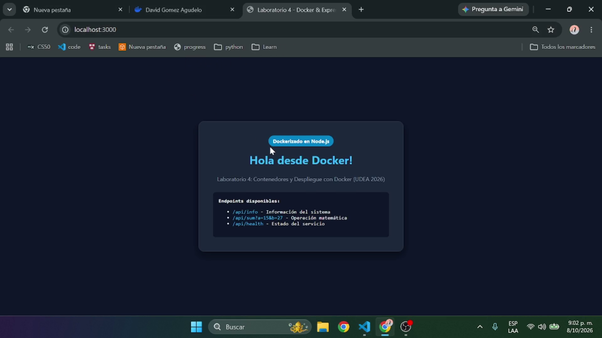
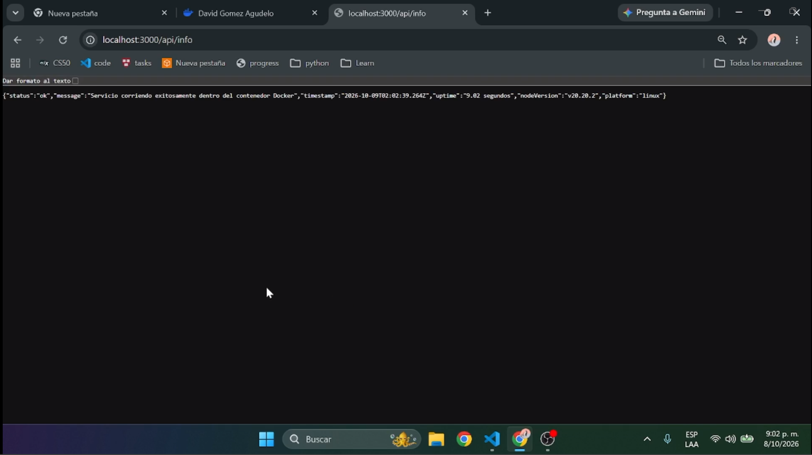
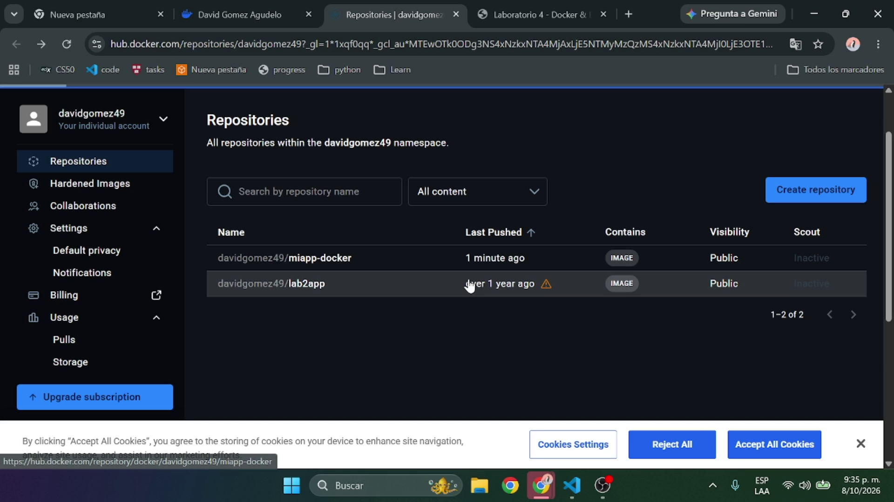
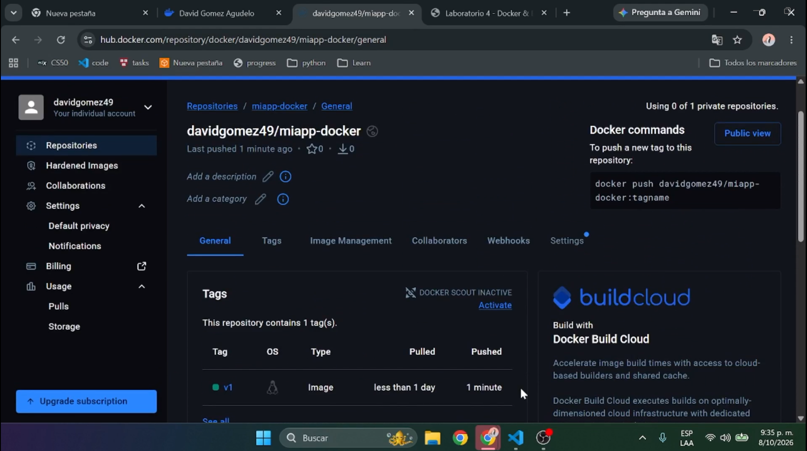

# Laboratorio 4 - Contenedores y Despliegue con Docker (UDEA)

Este proyecto contiene una aplicación web en **Node.js** con **Express**, empaquetada en un contenedor **Docker** (UDEA 2026).

David Gomez Agudelo
Santiago Trespalacios Bolivar
Juan Camilo Arboleda Arboleda
---

## Estructura del Proyecto

* [`app.js`](file:///c:/Users/David%20Gomez/Desktop/proyectos/Cloud/cloud-4/app.js): Código fuente principal de la aplicación HTTP Express.
* [`package.json`](file:///c:/Users/David%20Gomez/Desktop/proyectos/Cloud/cloud-4/package.json): Definición de dependencias y scripts de ejecución.
* [`Dockerfile`](file:///c:/Users/David%20Gomez/Desktop/proyectos/Cloud/cloud-4/Dockerfile): Configuración para construir la imagen de Docker basada en `node:20-alpine`.
* [`.dockerignore`](file:///c:/Users/David%20Gomez/Desktop/proyectos/Cloud/cloud-4/.dockerignore): Archivos omitidos durante la construcción de la imagen.

---

## Capturas de Pantalla de la Entrega

### 1. Contenedor Corriendo Localmente


### 2. Pruebas de Endpoints de la API


### 3. Publicación en Docker Hub




---

## Pasos de Ejecución y Pruebas

### 1. Probar Localmente (sin Docker)
```bash
npm install
npm start
```
Accede a `http://localhost:3000`.

---

### 2. Construir la Imagen Docker
Ejecuta en la terminal en la raíz del proyecto:
```bash
docker build -t miapp-docker:v1 .
```

---

### 3. Ejecutar el Contenedor Docker Localmente
```bash
docker run -d -p 3000:3000 --name contenedor-lab4 miapp-docker:v1
```

#### Probar los Endpoints en el Navegador o Postman:
* **UI Principal**: [http://localhost:3000](http://localhost:3000)
* **Metadata del Sistema**: [http://localhost:3000/api/info](http://localhost:3000/api/info)
* **Operación Matemática**: [http://localhost:3000/api/sum?a=15&b=27](http://localhost:3000/api/sum?a=15&b=27)
* **Health Check**: [http://localhost:3000/api/health](http://localhost:3000/api/health)

---

### 4. Publicar la Imagen en Docker Hub

1. Inicia sesión en Docker Hub desde la terminal (reemplaza `[usuario_dockerhub]` por tu usuario real):
   ```bash
   docker login -u [usuario_dockerhub]
   ```
2. Etiqueta la imagen vinculándola a tu cuenta:
   ```bash
   docker tag miapp-docker:v1 [usuario_dockerhub]/miapp-docker:v1
   ```
3. Sube la imagen a Docker Hub:
   ```bash
   docker push [usuario_dockerhub]/miapp-docker:v1
   ```

---

### 5. Probar en un Entorno Limpio (Opcional)

Para verificar que cualquier usuario puede descargar y ejecutar la imagen directamente desde Docker Hub sin tener el código fuente ni Node.js instalado:

1. Detén y elimina el contenedor local actual:
   ```bash
   docker stop contenedor-lab4
   docker rm contenedor-lab4
   ```
2. Elimina la imagen local compilada:
   ```bash
   docker rmi miapp-docker:v1
   docker rmi davidgomez49/miapp-docker:v1
   ```
3. Descarga la imagen directa desde Docker Hub:
   ```bash
   docker pull davidgomez49/miapp-docker:v1
   ```
4. Ejecuta la imagen descargada:
   ```bash
   docker run -d -p 3000:3000 --name prueba-limpia davidgomez49/miapp-docker:v1
   ```
5. Comprueba el funcionamiento ingresando a `http://localhost:3000`.

